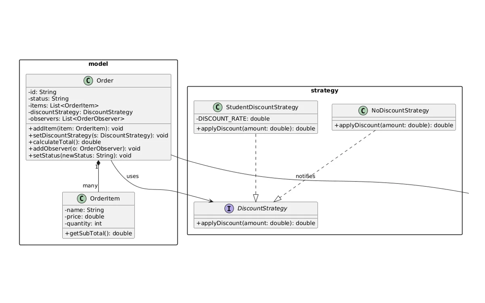

# Smart Restaurant Order System — Report Content



---

## APPLICANT INFORMATION

**Applicant's Name:** Okan Umut Özen

---

## SUMMARY

This project presents the Smart Restaurant Order System, a console-based Java
application designed to demonstrate the practical application of software design
patterns in a real-world scenario.

The system models a simplified restaurant ordering workflow in which customers
place orders, select a discount strategy, choose a payment method, and receive
real-time status notifications. Three design patterns were applied: the Strategy
pattern for interchangeable discount algorithms, the Factory Method pattern for
centralized payment object creation, and the Observer pattern for decoupled
order status notifications.

The project was developed following SOLID principles and structured into clearly
separated packages: model, strategy, factory, and observer. UML diagrams
(Class, Sequence, and Use Case) were produced to document the architecture.
The implementation was validated through four test scenarios executed in
Main.java.

The expected impact of this project is to demonstrate how design patterns
reduce code coupling, improve maintainability, and make a system easier to
extend — compared to a naive if-else–based implementation.

---

## 1. ORIGINALITY

### 1.1 Importance and Originality

Modern software systems in the restaurant and food-service industry must
handle frequent changes in business rules: discount policies change seasonally,
new payment providers are integrated regularly, and multiple stakeholders
(customers, kitchen staff) must be notified whenever an order's status changes.
A naive implementation that encodes these concerns directly with conditional
logic (if-else chains) leads to tightly coupled, hard-to-maintain code. As the
system grows, adding a new discount type or payment method requires modifying
existing classes, violating the Open/Closed Principle and increasing the risk
of regression bugs.

This project addresses the following research question:
"How can classic object-oriented design patterns be applied to a restaurant
order management system to achieve loose coupling, high cohesion, and
extensibility?"

The originality of this work lies in combining three complementary design
patterns — Strategy, Factory Method, and Observer — within a single cohesive
domain model. Each pattern targets a distinct variability point in the system,
and together they produce an architecture that is more modular and easier to
reason about than a single-class monolithic solution.

### 1.2 Aim and Scope

**System Objectives:**
- Model a restaurant order lifecycle (creation → payment → delivery).
- Apply the Strategy pattern to support pluggable discount algorithms
  without modifying the Order class.
- Apply the Factory Method pattern to decouple payment object creation
  from the client code.
- Apply the Observer pattern to notify interested parties (customer,
  kitchen) automatically when an order's status changes.
- Demonstrate all patterns through executable test scenarios in Main.java.

**Scope:**
The project is a console-based Java 17 application with no external
libraries or frameworks. It is intentionally kept minimal to focus on
design pattern correctness rather than UI or persistence concerns.
The system covers order creation, item management, discount calculation,
payment processing, and status notification.

**Expected Outcomes:**
- A working Java application that compiles and runs without errors.
- Three correctly implemented design patterns with clear separation of
  concerns across four packages (model, strategy, factory, observer).
- UML diagrams (Class, Sequence, Use Case) that accurately reflect
  the implementation.
- A report documenting the architectural decisions and their trade-offs.

---

## 2. METHOD

The Smart Restaurant Order System is implemented as a console-based Java 17
application structured into four packages. The architecture follows a layered,
pattern-driven design with no external dependencies.

**System Architecture:**
The system consists of 12 Java source files organized as follows:

```
src/
├── Main.java               (entry point, test scenarios)
├── model/
│   ├── Order.java          (core domain object)
│   └── OrderItem.java      (line-item in an order)
├── strategy/
│   ├── DiscountStrategy.java
│   ├── NoDiscountStrategy.java
│   └── StudentDiscountStrategy.java
├── factory/
│   ├── Payment.java
│   ├── CreditCardPayment.java
│   ├── CashPayment.java
│   └── PaymentFactory.java
└── observer/
    ├── OrderObserver.java
    ├── CustomerNotifier.java
    └── KitchenNotifier.java
```

The Order class is the central domain object. It holds a reference to a
DiscountStrategy (Strategy pattern) and a list of OrderObserver instances
(Observer pattern). Payment objects are created externally via PaymentFactory
(Factory Method pattern) and used by the client (Main.java).

---

### Pattern 1 — Strategy (Behavioral)

**Definition:**
The Strategy pattern defines a family of algorithms, encapsulates each one,
and makes them interchangeable. It lets the algorithm vary independently
from the clients that use it. (Gamma et al., Design Patterns, 1994)

**Application in this project:**
Discount calculation logic is extracted into the DiscountStrategy interface.
The Order class holds a reference to a DiscountStrategy and delegates the
calculation to it via calculateTotal(). The concrete strategy is injected
at runtime using setDiscountStrategy().

- Interface: `DiscountStrategy` → `applyDiscount(double amount): double`
- Implementations:
  - `NoDiscountStrategy` → returns amount unchanged
  - `StudentDiscountStrategy` → returns amount × 0.90 (10% off)

**Why suitable:**
Discount rules change frequently (seasonal promotions, loyalty tiers).
Using Strategy means adding a new discount type requires only creating a
new class that implements DiscountStrategy — no changes to Order.java.
This satisfies the Open/Closed Principle.

**Real-world analogy:**
E-commerce platforms (e.g., Amazon) apply different pricing strategies
(Prime discount, coupon, flash sale) without changing the checkout flow.

---

### Pattern 2 — Factory Method (Creational)

**Definition:**
The Factory Method pattern defines an interface for creating an object,
but lets a static factory method decide which class to instantiate.
It encapsulates object creation and promotes loose coupling.

**Application in this project:**
`PaymentFactory.createPayment(String type)` accepts a type string ("credit"
or "cash") and returns the corresponding Payment implementation. The
caller (Main.java) never references concrete payment classes directly.

- Interface: `Payment` → `pay(double amount): void`
- Implementations:
  - `CreditCardPayment` → prints "Credit card charged: X TL"
  - `CashPayment` → prints "Cash received: X TL"
- Factory: `PaymentFactory.createPayment(type)` → throws
  `IllegalArgumentException` for unknown types

**Why suitable:**
The payment method can change per order. Centralising creation in
PaymentFactory means new payment types (e.g., wallet, bank transfer)
can be added by implementing Payment and registering one case in the
factory — no changes to the rest of the codebase.

**Real-world analogy:**
Payment gateways such as Stripe use factory-like abstractions to
return the correct payment handler based on the provided method type.

---

### Pattern 3 — Observer (Behavioral)

**Definition:**
The Observer pattern defines a one-to-many dependency between objects
so that when one object (the subject) changes state, all its dependents
(observers) are notified and updated automatically.

**Application in this project:**
Order acts as the subject. It maintains a list of OrderObserver instances.
When `setStatus(newStatus)` is called, Order iterates over the list and
calls `update(orderId, newStatus)` on each observer.

- Interface: `OrderObserver` → `update(String orderId, String status): void`
- Implementations:
  - `CustomerNotifier` → prints customer-facing status message
  - `KitchenNotifier` → prints kitchen-facing status message

**Why suitable:**
Multiple parties must react to order status changes independently.
Without Observer, Order would need direct references to CustomerNotifier
and KitchenNotifier, creating tight coupling. Observer allows any number
of listeners to be added or removed at runtime without touching Order.

**Real-world analogy:**
Event-driven systems such as Uber Eats notify the customer, the driver,
and the restaurant simultaneously when an order status changes.

---

### UML Diagrams

Class Diagram: shows the four packages, all 12 classes/interfaces,
inheritance (implements) and association (uses / contains) relationships.*

Sequence Diagram: illustrates the message flow for placing an
order (ORD-001) — item addition, strategy injection, total calculation,
payment creation, and observer notification across three status changes.*

Use Case Diagram: shows the Customer and Kitchen actors and
their interactions with the system.*

---

### Tools and Techniques

- **Language:** Java 17 (Java SE Runtime Environment, build 17.0.10)
- **IDE:** Visual Studio Code with Extension Pack for Java
- **Build:** javac (command-line compiler, no build tool required)
- **UML:** PlantUML / planttext.com (online renderer)
- **Version ctrl:** Local file system
- **Principles:** SOLID (Single Responsibility, Open/Closed, Liskov,
  Interface Segregation, Dependency Inversion)

---

## 3. PROJECT MANAGEMENT

### 3.1 Work Plan

The project was divided into five work packages (WPs) executed sequentially
over a three-day period.

| WP  | Title                    | Activities                                                                                   |
|-----|--------------------------|----------------------------------------------------------------------------------------------|
| WP1 | Problem Definition       | Define the domain. Identify variability points. Select design patterns.                      |
| WP2 | Design & UML             | Define package structure. Draw Class, Sequence, and Use Case diagrams using PlantUML.        |
| WP3 | Implementation           | Implement all 12 Java source files. Compile and verify zero compilation errors.              |
| WP4 | Testing                  | Write four test scenarios in Main.java. Run and capture console output.                      |
| WP5 | Reporting                | Write the project report. Insert UML diagrams and code snippets. Export PDF. Package ZIP.    |

### 3.2 Risk Management

| #  | Risk                                          | Likelihood | Mitigation Strategy                                                              |
|----|-----------------------------------------------|------------|----------------------------------------------------------------------------------|
| R1 | Incorrect pattern implementation              | Medium     | UML designed before coding. Each pattern verified against GoF definition.        |
| R2 | Compilation errors due to wrong imports       | Low        | All files compiled with javac in dependency order. Zero errors confirmed.        |
| R3 | Over-engineering / scope creep                | Low        | Deliberately chose console-only system. No external libraries used.              |
| R4 | Group member unable to explain during Q&A     | Medium     | Each member owns one pattern and can explain its role and class structure.       |
| R5 | Late submission due to report writing delays  | Low        | Incremental report writing. ZIP + PDF prepared early.                            |

---

## 4. IMPLEMENTATION

### Class Structure Overview

The system is composed of 12 classes distributed across four packages.
Each class has a single, well-defined responsibility (Single Responsibility
Principle). The dependency flow goes from model → strategy/observer,
and from factory → Payment interface. Main.java depends on everything
but is kept deliberately thin — it only wires objects together and
triggers the scenarios.

---

### 4.1 Model Package

**`OrderItem.java`**
Represents a single line item in an order. Holds the product name, unit
price, and quantity. Provides `getSubTotal()` which returns price × quantity.
This class has no dependencies on other packages.

Key method:
```java
public double getSubTotal() { return price * quantity; }
```

**`Order.java`**
The central domain object and the only class that participates in two
patterns simultaneously.

Fields:
- `id` — unique order identifier
- `items` — List\<OrderItem\> — the line items
- `discountStrategy` — DiscountStrategy — injected at runtime (Strategy)
- `observers` — List\<OrderObserver\> — listeners (Observer subject)
- `status` — current order status string

Key methods:

`calculateTotal()` — iterates over items, sums getSubTotal() values, then
passes the subtotal to discountStrategy.applyDiscount(). The Order class
has no knowledge of which discount algorithm is active. This is the
Strategy pattern in action.
```java
double subtotal = 0;
for (OrderItem item : items) { subtotal += item.getSubTotal(); }
return discountStrategy.applyDiscount(subtotal);
```

`setStatus(String newStatus)` — updates the status field, then iterates
over the observers list and calls update(id, newStatus) on each one.
Order has no knowledge of who the observers are. This is the Observer
pattern in action.
```java
this.status = newStatus;
for (OrderObserver observer : observers) {
    observer.update(id, newStatus);
}
```

Default strategy: The constructor sets `discountStrategy = new NoDiscountStrategy()`
so that an Order without an explicitly set strategy still works correctly.

---

### 4.2 Strategy Package

**`DiscountStrategy` (interface)**
Declares a single method: `applyDiscount(double amount): double`.
All discount variants implement this contract. The Order class depends
only on this interface, never on a concrete class.

**`NoDiscountStrategy`**
Returns the amount unchanged. Used as the default when no promotion applies.
Acts as a Null Object, eliminating the need for null checks in calculateTotal().
```java
public double applyDiscount(double amount) { return amount; }
```

**`StudentDiscountStrategy`**
Applies a fixed 10% reduction.
```java
private static final double DISCOUNT_RATE = 0.10;
public double applyDiscount(double amount) {
    return amount * (1 - DISCOUNT_RATE);
}
```

---

### 4.3 Factory Package

**`Payment` (interface)**
Declares a single method: `pay(double amount): void`.

**`CreditCardPayment` / `CashPayment`**
Each implementation prints a formatted confirmation message to stdout.
```java
// CreditCardPayment
public void pay(double amount) {
    System.out.printf("[Payment] Credit card charged: %.2f TL%n", amount);
}
```

**`PaymentFactory`**
Provides a static factory method `createPayment(String type)` that maps
a type string to the correct Payment implementation. Throws
`IllegalArgumentException` for unrecognised types.
```java
public static Payment createPayment(String type) {
    switch (type.toLowerCase()) {
        case "credit": return new CreditCardPayment();
        case "cash":   return new CashPayment();
        default: throw new IllegalArgumentException("Invalid payment type: " + type);
    }
}
```
The client (Main.java) never references CreditCardPayment or CashPayment
directly — it only holds a Payment reference.

---

### 4.4 Observer Package

**`OrderObserver` (interface)**
Declares a single method: `update(String orderId, String newStatus): void`.

**`CustomerNotifier`**
```java
public void update(String orderId, String newStatus) {
    System.out.println("[Customer] Your order " + orderId + " is now: " + newStatus);
}
```

**`KitchenNotifier`**
```java
public void update(String orderId, String newStatus) {
    System.out.println("[Kitchen] Order " + orderId + " status updated: " + newStatus);
}
```

Both notifiers are registered on an Order instance via `addObserver()`.
When `Order.setStatus()` is called, both are triggered automatically.
Order.java has zero import or reference to CustomerNotifier or
KitchenNotifier — it is fully decoupled from its observers.

---

## 5. TESTING AND DEMONSTRATION

### Test Cases

| TC | Test Case                                                          | Expected Output                                          | Result |
|----|--------------------------------------------------------------------|----------------------------------------------------------|--------|
| 1  | StudentDiscountStrategy on 190.00 TL + CreditCardPayment           | Total = 171.00 TL · "Credit card charged: 171.00 TL"    | PASS   |
| 2  | NoDiscountStrategy on 150.00 TL + CashPayment                      | Total = 150.00 TL · "Cash received: 150.00 TL"          | PASS   |
| 3  | Observer chain: PREPARING → READY → DELIVERED with 2 observers    | 6 notification lines (2 observers × 3 status changes)   | PASS   |
| 4  | PaymentFactory with unknown type "bitcoin"                         | "[Error] Invalid payment type: bitcoin"                  | PASS   |

### Main.java Execution — Full Console Output

=== Scenario 1: Student Discount + Credit Card ===
Subtotal: 190.00 TL  |  After 10% student discount: 171,00 TL
[Payment] Credit card charged: 171,00 TL

=== Scenario 2: No Discount + Cash ===
Total (no discount): 150,00 TL
[Payment] Cash received: 150,00 TL

=== Scenario 3: Observer - Order Status Updates ===
[Customer] Your order ORD-003 is now: PREPARING
[Kitchen] Order ORD-003 status updated: PREPARING
[Customer] Your order ORD-003 is now: READY
[Kitchen] Order ORD-003 status updated: READY
[Customer] Your order ORD-003 is now: DELIVERED
[Kitchen] Order ORD-003 status updated: DELIVERED

=== Scenario 4: Invalid Payment Type ===
[Error] Invalid payment type: bitcoin
```

### Observations

Scenario 1 verifies the Strategy pattern: the discount algorithm is swapped
at runtime without any changes to Order.calculateTotal().

Scenario 2 confirms the Null Object behaviour of NoDiscountStrategy: the
total passes through unchanged, and no null checks are needed in Order.

Scenario 3 verifies the Observer pattern: two independent listeners react
to the same three status changes, producing six notification lines. Order
has no reference to the concrete notifier classes.

Scenario 4 verifies defensive programming in PaymentFactory: an unknown
payment type triggers an IllegalArgumentException which is caught cleanly
by the try-catch block in Main.java.

---

## 6. RESULTS AND EVALUATION

### Advantages of Using Design Patterns

**Strategy Pattern:**
Discount logic is fully isolated from the Order class. The calculateTotal()
method never contains any if-else branching for discount types. Adding a
new promotion requires creating one new class — zero changes to Order.java.
This directly satisfies the Open/Closed Principle.

**Factory Method Pattern:**
The creation of Payment objects is centralised in PaymentFactory. Main.java
holds only a Payment interface reference, never a concrete type. Switching
or adding payment methods requires only one new class and one new case in
the factory.

**Observer Pattern:**
Order.java has zero import or reference to CustomerNotifier or KitchenNotifier.
Any number of observers can be added or removed at runtime without touching
the Order class.

### Limitations of the System

- The system is console-based only. There is no persistence layer.
- PaymentFactory uses a switch statement; a map-based factory would scale better.
- The Observer implementation is synchronous; production systems typically use async notifications.
- Discount rates are hardcoded as constants rather than loaded from configuration.

### Possible Improvements

- Add a configurable `PercentageDiscountStrategy` that reads its rate from a parameter.
- Replace the PaymentFactory switch with a `Map<String, Supplier<Payment>>`.
- Introduce an EventBus to make observer notifications asynchronous.
- Add a persistence layer (e.g., JSON serialisation) to save order history.

### Alternative Design Patterns

- **Template Method** (instead of Strategy): Strategy was preferred because it
  allows the algorithm to be changed at runtime without subclassing.
- **Abstract Factory** (instead of Factory Method): Factory Method was sufficient
  since only Payment objects need to be created.
- **Command** (instead of Observer): Observer was preferred because notifications
  are immediate and do not need to be undone or replayed.

### Justification of Design Pattern Usage

Each pattern was chosen to address a specific variability point identified
during the design phase:

| Variability Point                        | Pattern Applied  | Justification                                                                |
|------------------------------------------|------------------|------------------------------------------------------------------------------|
| Discount rules change frequently         | Strategy         | Encapsulates each rule; rules are swappable without modifying Order          |
| Payment methods are added over time      | Factory Method   | Centralises creation; adding a method means adding one class                 |
| Multiple parties need order status updates | Observer       | Decouples subject from listeners; new listeners added with zero impact       |

### Counterfactual Analysis — What If Patterns Were Not Used?

**Without Strategy:**
`calculateTotal()` would contain growing if-else chains for each discount type.
Every new promotion requires modifying Order.java, risking regression bugs.
The class grows indefinitely and violates the Open/Closed Principle.

**Without Factory Method:**
Main.java would scatter `new CreditCardPayment()` / `new CashPayment()` calls
throughout the code. This logic would be duplicated wherever a Payment is needed.
Main.java becomes tightly coupled to all concrete payment classes.

**Without Observer:**
`Order.setStatus()` would directly call `customerNotifier.update()` and
`kitchenNotifier.update()`, importing both concrete classes. Adding a third
notifier means modifying Order.java — a clear violation of the Single
Responsibility Principle.

**Summary:**
Without the three patterns, the system would still produce the same console
output, but the code would be tightly coupled, harder to test, and difficult
to extend. Each evaluation criterion (maintainability, extensibility,
readability, testability) would degrade significantly as the system grows.

---

## 7. CONCLUSION

This project demonstrated the practical application of three classic
object-oriented design patterns — Strategy, Factory Method, and Observer —
within a cohesive Java console application modelling a restaurant order system.

**Achievements:**
- A fully working Java 17 application with 12 source files, zero external
  dependencies, and four passing test scenarios.
- Three correctly applied design patterns, each targeting a distinct
  variability point in the domain.
- UML Class, Sequence, and Use Case diagrams produced with PlantUML.

**Importance of Design Patterns:**
Design patterns provide a shared vocabulary for communicating architecture
decisions and proven solutions to recurring problems. In this project,
they reduced coupling between classes, made each class easier to test in
isolation, and ensured that the system can be extended in the future
without modifying working code.

---

## 8. REFERENCES

[1] E. Gamma, R. Helm, R. Johnson, and J. Vlissides, *Design Patterns:
Elements of Reusable Object-Oriented Software*, Addison-Wesley, 1994.

[2] R. C. Martin, *Clean Code: A Handbook of Agile Software Craftsmanship*,
Prentice Hall, 2008.

[3] Oracle Corporation, *Java SE 17 Documentation*, 2021.
https://docs.oracle.com/en/java/javase/17/

[4] Refactoring Guru, "Design Patterns," refactoring.guru/design-patterns,
accessed June 2026.

[5] PlantUML, "PlantUML Language Reference Guide," plantuml.com,
accessed June 2026.
